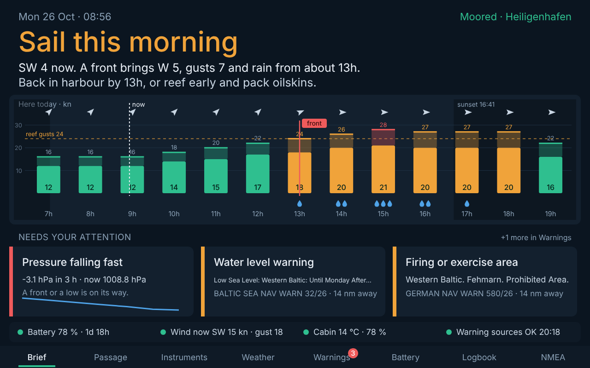
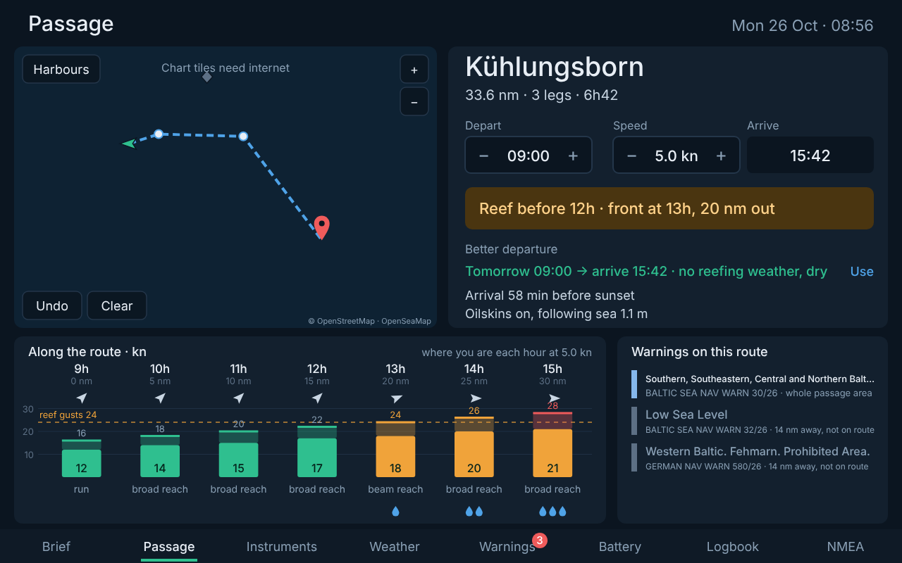

# Sailpartner

A morning brief and logbook screen for a Hanse 323, running on a Raspberry Pi with OpenPlotter and Signal K, fed by NMEA 2000.

| Brief — here, today | Passage — a trip |
|---|---|
|  |  |

## Packages

| Package | What it does | Status |
|---|---|---|
| [`signalk-baltic-warnings`](packages/signalk-baltic-warnings) | Signal K plugin: navigational warnings for the Baltic (BALTICO/NAVTEX for all Baltic states, Digitraffic, on-board barometer), filtered by position and route, published as notifications, chart regions/notes and a REST API | v0.1, tests passing, live sources to be confirmed on the Pi |
| [`sailpartner`](packages/sailpartner) | Signal K plugin + web app: **Brief** (verdict and day ribbon for here, attention cards), **Passage** (tap a route on the chart: weather along the way at your speed, trip verdict, better departure time, warnings on the route), **Instruments** (wind dial, battery, barometer), **Weather** (48 h), **Warnings**, **Battery** (7 days), **Logbook** (automatic and manual entries, CSV export) and **NMEA** (all live data with PGN/sentence and source) | v0.3, tests passing, not yet run on a boat |

## Contents

- [Try it on your laptop](#try-it-on-your-laptop)
  - [A. Demo mode — no boat, no Signal K](#a-demo-mode--no-boat-no-signal-k)
  - [B. A real Signal K server with recorded boat data](#b-a-real-signal-k-server-with-recorded-boat-data)
- [Installation on the Raspberry Pi](#installation-on-the-raspberry-pi)
  1. [What you need](#1-what-you-need)
  2. [Flash OpenPlotter](#2-flash-openplotter)
  3. [First boot and basics](#3-first-boot-and-basics)
  4. [Signal K: first login](#4-signal-k-first-login)
  5. [NMEA 2000 via the PiCAN-M](#5-nmea-2000-via-the-pican-m)
  6. [Barometer, temperature and humidity (BME280)](#6-barometer-temperature-and-humidity-bme280)
  7. [Victron SmartShunt via Bluetooth](#7-victron-smartshunt-via-bluetooth)
  8. [Helper plugins from the Signal K App Store](#8-helper-plugins-from-the-signal-k-app-store)
  9. [Install Sailpartner and Baltic Warnings](#9-install-sailpartner-and-baltic-warnings)
  10. [Configure the two plugins](#10-configure-the-two-plugins)
  11. [Check the warning sources](#11-check-the-warning-sources)
  12. [The 10.1" screen in kiosk mode](#12-the-101-screen-in-kiosk-mode)
  13. [Updating](#13-updating)
  14. [Troubleshooting](#14-troubleshooting)
- [Development](#development)

---

## Try it on your laptop

You need [Node.js](https://nodejs.org) 18 or newer (the LTS installer is fine) and [git](https://git-scm.com).

### A. Demo mode — no boat, no Signal K

A simulated morning in Heiligenhafen on 26 October 2026 with a front coming in. Wind, gusts, rain and pressure are made up, the warnings come from a saved copy of the BALTICO page. Nothing to install, works offline (only the chart tiles need internet).

```bash
git clone https://github.com/polimux/sailpartner.git
cd sailpartner/packages/sailpartner
npm run demo
```

Open **http://localhost:3333** in your browser and stop the demo with **Ctrl+C**.

Things to try:

- **Brief**: the verdict, the day ribbon with gust bars, the attention cards.
- **Passage**: pick *Kühlungsborn* or tap points on the chart. Change departure and speed with −/+, tap *Use* on the better departure.
- **Instruments**: wind dial, wind history, battery, barometer.
- **Weather**: 48 hours of wind and gusts, rain and waves, pressure measured and forecast, the next days.
- **Warnings**: all warnings with filters, full text, source health.
- **Battery**: 7 days of charge, Ah charged and used per day.
- **Logbook**: yesterday's sail (◀), quick entries and notes for today, CSV export.
- **NMEA**: every value arriving in Signal K, live, with its PGN or sentence and source. In the demo it's simulated traffic; on a real server it's your boat's data — the quickest way to see what Sailpartner actually receives.

To see it as on the boat's 10.1" screen, make the browser window 1280 × 800 or go full screen (F11 on Windows/Linux, Ctrl+Cmd+F on Mac).

### B. A real Signal K server with recorded boat data

This is the important test: it checks that Sailpartner reads the Signal K data paths correctly and fetches the real forecast from Open-Meteo (internet needed). The steps work on **Windows, Mac and Linux**. On Windows use *PowerShell* or the *Command Prompt*.

1. Install Signal K and start it with its built-in sample NMEA 2000 data. Tell it explicitly to keep its settings in the `.signalk` folder in your home folder (`-c`), so the install script finds it:

   **Windows (PowerShell):**
   ```powershell
   npm install -g signalk-server
   mkdir $HOME\.signalk
   signalk-server -c $HOME\.signalk --sample-n2k-data --override-timestamps
   ```
   **Mac / Linux:**
   ```bash
   npm install -g signalk-server
   mkdir -p ~/.signalk
   signalk-server -c ~/.signalk --sample-n2k-data --override-timestamps
   ```
   (`--override-timestamps` replaces the recorded timestamps with the current time. Leave this window open — it is the running server.)
2. Open **http://localhost:3000** and create the admin user.
3. In a second terminal, go to your clone of this repository and install the two plugins:
   ```bash
   cd sailpartner
   node scripts/install.js
   ```
   It pulls the latest version, installs both plugins into your Signal K folder (`C:\Users\<you>\.signalk` on Windows, `~/.signalk` on Mac/Linux) and asks you to restart Signal K.
4. Stop Signal K with **Ctrl+C** in the first terminal and start it again with the same command (including `-c …`).
5. In Signal K: **Server → Plugin Config** → enable **Sailpartner** and **Baltic Warnings** → **Submit** each.
6. Open **http://localhost:3000/sailpartner/**.

What to expect:

- The sample data comes from somewhere else than the Baltic, so the place shows as *At sea* or *At anchor*, and the Baltic warnings will mostly be "far".
- The sample data probably has no SmartShunt and no BME280: you'll see *Battery: no data* and no barometer trend. That's correct behaviour.
- The 3-hour wind history and the barometer trend fill up while the server runs.
- If you sail in the Baltic, try the warnings probe as well: `node packages/signalk-baltic-warnings/bin/probe.js 54.373 11.004` (from the repository folder).

If something looks wrong, open an issue with a screenshot and the Signal K server log (**Server → Server Log**).

---

## Installation on the Raspberry Pi

Plan about two hours for a first install. Steps 1–8 set up a standard OpenPlotter/Signal K boat computer; steps 9–12 add Sailpartner.

### 1. What you need

| Part | Notes |
|---|---|
| Raspberry Pi 4 (4 GB) or Pi 5 | Pi 5 needs a 5 V / 5 A supply |
| Storage | microSD 16 GB+ to start. A USB SSD is strongly recommended for a boat that runs all day: SD cards wear out from constant logging |
| PiCAN-M HAT (Copperhill) | NMEA 2000 (Micro-C connector) and NMEA 0183, Qwiic I2C connector |
| NMEA 2000 drop cable | Micro-C, from a free T-piece on your backbone to the PiCAN-M |
| BME280 sensor | Pressure, temperature, humidity on I2C (Qwiic connector on the PiCAN-M or GPIO pins) |
| Victron SmartShunt | Already on board; read via Bluetooth |
| 10.1" HDMI touch display, 1280×800 | 5 V / 3 A, HDMI + USB for touch. Pi 4/5 need a micro-HDMI → HDMI cable |
| 12 V → 5 V converter | A marine-grade buck converter, at least 5 A for Pi 4 + display, 8 A for Pi 5 + display. Fused on the 12 V side |
| Internet on board | Marina Wi-Fi or a 4G router — needed for forecasts and warnings |

### 2. Flash OpenPlotter

OpenPlotter is Raspberry Pi OS with the marine apps (Signal K, CAN, I2C, OpenCPN …) pre-installed.

1. Download **OpenPlotter Starting** from the [OpenPlotter download page](https://openplotter.readthedocs.io/latest/getting_started/downloading.html). There is also a *Headless* edition (no screen, Wi-Fi access point) and a *Touchscreen* edition for DSI screens — for an HDMI display, *Starting* is the right one.
2. Install [Raspberry Pi Imager](https://www.raspberrypi.com/software/) on your computer.
3. In Imager: **CHOOSE OS → Use custom** → select the downloaded OpenPlotter file (no need to unzip).
4. **CHOOSE STORAGE** → your microSD card → **NEXT**.
5. When asked about custom OS settings, answer **NO**. The user must stay `pi`; OpenPlotter breaks if you rename it.
6. Put the card in the Pi, connect screen, keyboard/mouse and power.

Default login: user `pi`, password `raspberry`, hostname `openplotter`.

> **Booting from SSD:** flash plain Raspberry Pi OS (64-bit) to the microSD, boot it, download OpenPlotter there, and use *Accessories → Imager* to write OpenPlotter to the SSD. Then remove the microSD and boot from the SSD. Keep the microSD as a rescue disk. Details in the [OpenPlotter installing guide](https://openplotter.readthedocs.io/latest/getting_started/installing.html).

### 3. First boot and basics

1. **Change the password:** open a terminal and run `passwd`.
2. **Time zone and locale:** `sudo raspi-config` → *Localisation Options* → *Timezone* → Europe/Berlin (or wherever the boat lives). Sailpartner has its own time zone setting too, but logs and the clock should agree.
3. **Wi-Fi:** connect to the marina or your 4G router via the network icon at the top right.
4. **Update:** open **OpenPlotter → Settings**, check for updates of the OpenPlotter apps, and install them. Then in a terminal:
   ```bash
   sudo apt update && sudo apt full-upgrade -y
   sudo reboot
   ```
5. **Remote access (optional, handy):** `sudo raspi-config` → *Interface Options* → enable **SSH** and **VNC**, so you can work on the Pi from your laptop.

### 4. Signal K: first login

Signal K is the data hub: it turns NMEA 2000, sensors and plugins into one data model that every app can read.

1. On the Pi, open the browser at **http://localhost:3000** (from your laptop: `http://openplotter.local:3000`).
2. On first visit Signal K asks you to **create an admin user**. Write the password down.
3. Look around the admin UI: **Data Browser** (all live values), **Server → Connections** (data sources), **Server → Plugin Config**, **Appstore**.

If Signal K is not running, install it with **OpenPlotter → Signal K Installer**.

### 5. NMEA 2000 via the PiCAN-M

1. With the Pi **off**, mount the PiCAN-M on the GPIO header. Connect the Micro-C drop cable from the backbone to the PiCAN-M.
2. Open **OpenPlotter → CAN Bus** → tab **MCP2515** → **Add MCP251xxx device**:
   - Interface: **SPI0 CE0**
   - Oscillator: **16 MHz** (PiCAN-M)
   - Interrupt: **GPIO 25** (PiCAN-M)
3. **Reboot** when asked.
4. Back in **CAN Bus**, select the device → **Check device traffic**. You should see frames scrolling while your instruments are on.
5. Select the device → **Add Connection**. Signal K restarts and now reads NMEA 2000.
6. Check in Signal K → **Data Browser**: you should see `navigation.position`, `environment.wind.speedApparent`, `environment.wind.angleApparent`, `navigation.speedOverGround`, depth etc.

Details: [OpenPlotter MCP2515 guide](https://openplotter.readthedocs.io/latest/can/mcp2515.html), [PiCAN-M user guide](https://copperhilltech.com/content/pican-m_UGB_30.pdf).

> NMEA 2000 is read-only by default. Sailpartner never writes to the bus.

### 6. Barometer, temperature and humidity (BME280)

1. With the Pi off, connect the BME280 to the Qwiic connector of the PiCAN-M (or to the I2C GPIO pins: 3.3 V, GND, SDA = GPIO 2, SCL = GPIO 3). Mount it in the cabin, away from the engine, heater and direct sun.
2. **OpenPlotter → Settings**: make sure the **I2C** app is installed, then open **OpenPlotter → I2C**.
3. The I2C app asks Signal K for access: in the Signal K admin UI go to **Security → Access Requests**, approve **OpenPlotter I2C** with permission **Read/Write**, expiry **NEVER**.
4. In the I2C app: **Add** → sensor **BME280** → address **0x76** or **0x77** (depends on the board; try the other one if no values arrive).
5. Set the Signal K keys of the three values to what Sailpartner expects (or change the paths in the plugin config later):

   | Value | Signal K key |
   |---|---|
   | Pressure | `environment.outside.pressure` |
   | Temperature | `environment.inside.temperature` |
   | Humidity | `environment.inside.relativeHumidity` |

   ("outside" pressure is fine with the sensor in the cabin — the boat isn't pressurised.)
6. Check in the **Data Browser**: pressure around 100 000 Pa (= 1000 hPa), temperature in Kelvin (~290 K).

### 7. Victron SmartShunt via Bluetooth

The SmartShunt broadcasts its values over Bluetooth ("Instant readout"). The `signalk-victron-ble` plugin decodes them.

1. On the Pi, install Python's venv module (the plugin runs a small Python helper):
   ```bash
   sudo apt install -y python3-venv
   ```
2. On your phone, open **VictronConnect** → the SmartShunt → settings (⚙) → **⋮ → Product info**. Enable **Instant readout via Bluetooth**, then tap **Show** next to *Instant readout details* and note the **MAC address** and the **encryption key**.
3. Signal K → **Appstore → Available** → search **victron-ble** → install **signalk-victron-ble** → restart Signal K.
4. **Server → Plugin Config → Victron BLE**: add a device:
   - Signal K ID: `house`
   - Bluetooth MAC address and advertisement key from step 2
   - Enable the plugin, **Submit**, restart Signal K.
5. Check the **Data Browser** for `electrical.batteries.house.*` (state of charge, voltage, current).

If values drop out: the Pi's built-in Bluetooth is weak through bulkheads. A USB Bluetooth dongle on a short extension cable close to the SmartShunt fixes it. Plugin docs: [signalk-victron-ble](https://www.npmjs.com/package/signalk-victron-ble).

### 8. Helper plugins from the Signal K App Store

Signal K → **Appstore → Available**, search and install, then restart Signal K and enable each in **Plugin Config**:

| Plugin | Why |
|---|---|
| **signalk-derived-data** | Calculates true wind from apparent wind + speed + heading. In its config enable *True Wind* (and *Ground Wind* if you have no log). |
| **signalk-anchoralarm-plugin** | Anchor watch; Sailpartner shows the drift when you're at anchor |
| **@signalk/freeboard-sk** | Chart plotter in the browser; shows warning areas from Baltic Warnings |
| **signalk-logbook** *(optional)* | A full-featured logbook. Sailpartner keeps its own simple logbook, so this is only needed if you want its extra features |
| **signalk-to-influxdb2** *(optional)* | Long-term history in InfluxDB (install InfluxDB via **OpenPlotter → Dashboards** first) |

### 9. Install Sailpartner and Baltic Warnings

Both plugins live in this repository. They have no native dependencies — nothing to compile.

```bash
cd ~
git clone https://github.com/polimux/sailpartner.git
node ~/sailpartner/scripts/install.js
```

The script packs both plugins, installs them into `~/.signalk` and restarts Signal K. Then:

1. Signal K → **Server → Plugin Config** → enable **Baltic Warnings** → **Submit**.
2. Enable **Sailpartner** → **Submit**.
3. Open **http://localhost:3000/sailpartner/** — the Brief. The tabs at the bottom lead to **Passage** (plan a trip on the chart), **Instruments**, **Weather**, **Warnings**, **Battery**, **Logbook** and **NMEA** (all live data — check here first that your instruments arrive). It is also listed under **Webapps** in the Signal K menu and works on your phone or tablet on the boat's network (`http://openplotter.local:3000/sailpartner/`).

The first forecast arrives within a few seconds when the Pi has internet. The wind history fills over the first 3 hours, the barometer trend after 2½ hours.

### 10. Configure the two plugins

**Sailpartner** (Plugin Config → Sailpartner):

| Setting | Default | Notes |
|---|---|---|
| Time zone | Europe/Berlin | Used for all times on the screen |
| Planning speed | 5 kn | Default for the trip planner |
| Reef from mean wind / gusts | 18 kn / 24 kn | Tuned for a Hanse 323 — adjust to your boat and crew |
| Gusts shown red from | 28 kn | Route colour bars |
| "Stay in" from mean wind / gusts | 25 kn / 32 kn | |
| Battery id | empty = first found | e.g. `house` if you have several |
| Barometer / cabin paths | as in step 6 | Change if your sensor publishes elsewhere |
| Home port, destinations | Heiligenhafen + western Baltic harbours | **Approximate positions, used only to sample the weather along the way — not for navigation.** Check and edit them |

**Baltic Warnings** (Plugin Config → Baltic Warnings):

| Setting | Default | Notes |
|---|---|---|
| Nearby radius | 30 nm | Warnings closer than this are "nearby" |
| Route corridor | 5 nm each side | Warnings this close to the planned route are "on route" |
| Notifications for | near me or on my route | What raises a Signal K notification |
| Barometer path | `environment.outside.pressure` | Same sensor as above |
| Sources | BALTICO, Digitraffic on; Latvia, Lithuania off (experimental); DWD, ELWIS probe only | |

### 11. Check the warning sources

Run the probe once to see that the live sources are reachable and parsed correctly (example position: Heiligenhafen):

```bash
cd ~/.signalk/node_modules/signalk-baltic-warnings
node bin/probe.js 54.373 11.004
```

It prints the warnings sorted by distance and saves the raw pages to `probe-output/`. If something looks wrong, open an issue in this repository with that folder attached.

### 12. The 10.1" screen in kiosk mode

Goal: the Pi boots straight into the full-screen morning brief.

1. **Log in once in Chromium** on the Pi at `http://localhost:3000` with your Signal K admin user if you have Signal K security enabled (the login cookie is kept, so the kiosk can read the data).
2. Create an autostart entry:
   ```bash
   mkdir -p ~/.config/autostart
   cat > ~/.config/autostart/sailpartner.desktop <<'EOF'
   [Desktop Entry]
   Type=Application
   Name=Sailpartner
   Exec=sh -c 'sleep 20; B=$(command -v chromium-browser || command -v chromium); exec "$B" --kiosk --noerrdialogs --disable-infobars --check-for-update-interval=31536000 http://localhost:3000/sailpartner/'
   X-GNOME-Autostart-enabled=true
   EOF
   ```
   The 20 s pause gives Signal K time to start.
3. **Screen blanking:** `sudo raspi-config` → *Display Options* → *Screen Blanking* → **No**, so the brief stays visible.
4. **Touch:** the display's USB cable carries touch; no driver needed. Tap the destination field to plan a trip.
5. Reboot to test: `sudo reboot`. To leave kiosk mode, press **Alt+F4** (keyboard) or log in via SSH and run `pkill chromium`.

> If your desktop session doesn't pick up `~/.config/autostart` (some Raspberry Pi OS versions with the *labwc* desktop), add the same command line to `~/.config/labwc/autostart` instead.

**Power tip:** the display draws up to 1 A. Turn the backlight down in the display's menu for the night, or switch the display off via its 5 V supply when you leave the boat.

### 13. Updating

```bash
node ~/sailpartner/scripts/install.js
```

It pulls the latest version from GitHub, reinstalls both plugins and restarts Signal K. Your settings, trip and history stay (they live in `~/.signalk/plugin-config-data/`).

### 14. Troubleshooting

| Symptom | Check |
|---|---|
| "Waiting for the forecast…" | Internet on the Pi? `curl -I https://api.open-meteo.com` should answer. Forecast errors are shown in the brief |
| Wind dial empty | Data Browser: `environment.wind.speedApparent` / `angleApparent` present? If not, check step 5 |
| True wind missing under way | Enable *True Wind* in signalk-derived-data; it needs boat speed and heading |
| "No battery data" | Data Browser: `electrical.batteries.*`? Check MAC/key in step 7, Bluetooth range, `sudo apt install python3-venv` |
| Barometer stays "trend after 3 h of data" | Normal for the first 2½ hours. If it never changes: is the pressure path right (step 6)? |
| "warnings plugin not reachable" | Is **Baltic Warnings** enabled in Plugin Config? |
| Kiosk shows "Could not load the brief: HTTP 401" | Signal K security: log in once in Chromium (step 12.1) |
| Plugins not listed after install | `sudo systemctl restart signalk`; check `~/.signalk/package.json` lists `sailpartner` and `signalk-baltic-warnings` |
| Signal K log | `journalctl -u signalk -f` or Signal K admin → **Server Log**; enable debug for `sailpartner` / `signalk-baltic-warnings` there |

---

## Development

Requires Node 18 or newer.

```bash
cd packages/signalk-baltic-warnings && npm test
cd packages/sailpartner && npm test
cd packages/sailpartner && npm run demo   # http://localhost:3333 — simulated morning, no boat needed
```

## Stack

- Raspberry Pi 4/5, PiCAN-M HAT (NMEA 2000), BME280 barometer on I2C, 10.1" 1280×800 touch display
- OpenPlotter: CAN Bus, I2C, Signal K, Dashboards (InfluxDB 2)
- Signal K plugins: `signalk-victron-ble` (SmartShunt), `signalk-derived-data`, `signalk-anchoralarm-plugin`, `@signalk/freeboard-sk`, optional `signalk-logbook` and `signalk-to-influxdb2`
- Forecasts: [Open-Meteo](https://open-meteo.com) (wind, gusts, rain, pressure, waves). Warnings: Sjöfartsverket/BALTICO, Fintraffic Digitraffic
