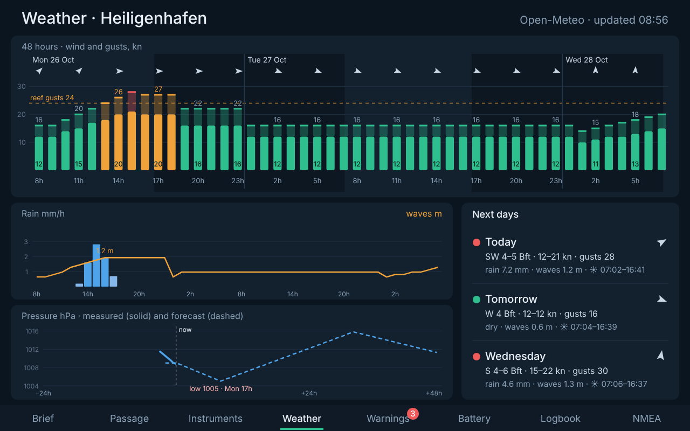
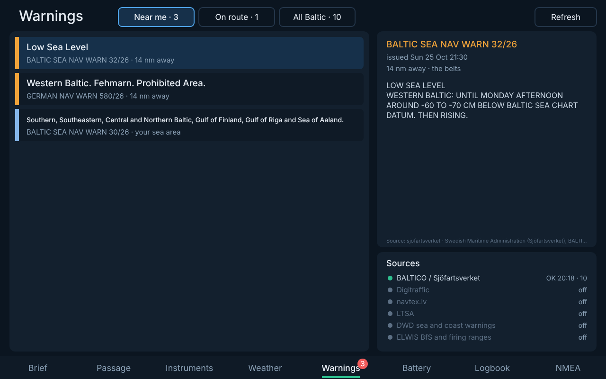
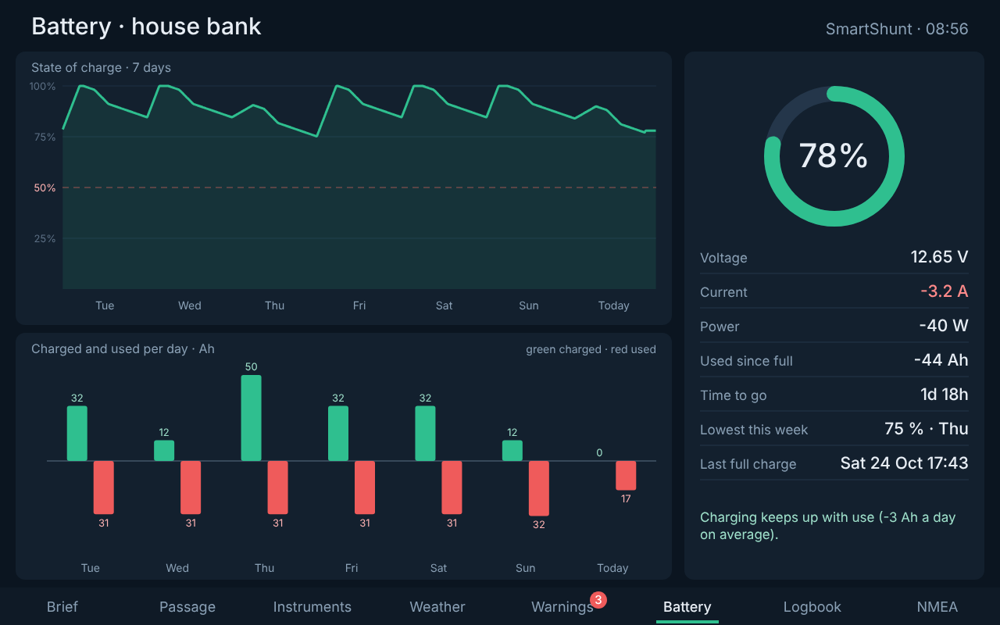
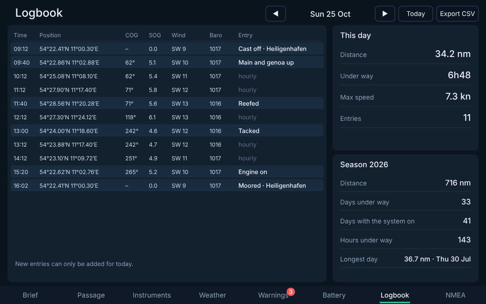
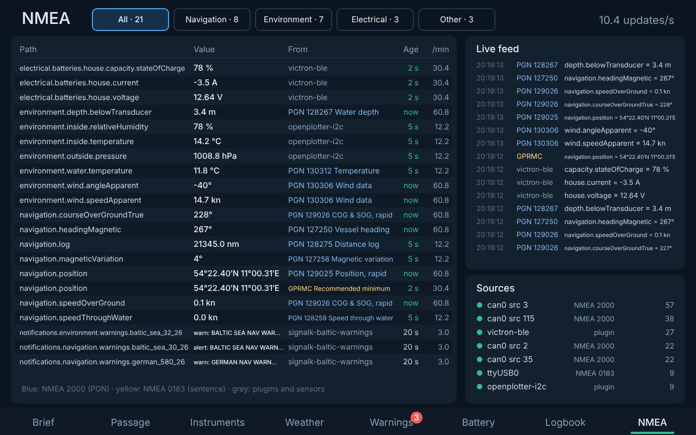

# Sailpartner

The morning brief screen for a sailing boat running Signal K. One look at the chart table tells you whether to go out today; a second tab plans the passage.

## Pages

### Brief — here, today


| Part | Content |
|---|---|
| Verdict | One answer for here and today: *Good sailing*, *Sail this morning*, *Sail until 15h*, *Reef before 12h*, *Stay in*. After 18h it looks at tomorrow |
| Two sentences | What the wind does (Beaufort, front, rain) and what to do about it |
| Day ribbon | 7h–19h at your position. One bar per hour: the solid part is the mean wind, the lighter top reaches up to the gusts. Green / amber (reef) / red. Dashed line: reef from gusts. Wind arrows, rain drops, *now*, the front and the dark hours after sunset |
| Needs your attention | At most three cards, only when something needs you: barometer falling or rising fast, warnings near you (from `signalk-baltic-warnings`), battery low, anchor drifting. Otherwise "Nothing needs your attention" |
| Status line | What's fine, at a glance: battery, wind now, cabin, warning sources |

### Passage — a trip


| Part | Content |
|---|---|
| Chart | OpenStreetMap with OpenSeaMap seamarks. **Tap to add waypoints**, the last one is your target; drag to pan, +/− to zoom, *Undo*, *Clear*, or *Harbours* to pick a saved one. Warnings are drawn on the chart: coloured when on your route, grey when only nearby |
| Trip | Distance, legs, duration; departure and speed with −/+; arrival |
| Trip verdict | e.g. *Reef before 12h · front at 13h, 20 nm out* |
| Better departure | Sailpartner tries every departure in 30-minute steps today and tomorrow (daylight) and suggests one with less strong wind, less rain and a daylight arrival. *Use* applies it |
| Along the route | The same gust bars, but for where you'll be each hour at your planning speed, with the point of sail for that leg and rain |
| Warnings on this route | From `signalk-baltic-warnings`, within the route corridor; nearby ones greyed out |

Without a trip the right side lists your saved harbours:


The chart tiles need internet (so does the forecast). They are cached by the browser.

### Instruments

Bow-up wind dial (A = apparent, T = true), true wind, 10-minute gust, the last 3 hours as arrows; SmartShunt battery; barometer over 24 hours with the 3-hour tendency.


### Weather



48 hours at your position with the same gust bars (nights shaded), rain and waves, the pressure measured on board joined to the forecast pressure (with the coming low or high), and the next three days in two lines each.

### Warnings



Everything from `signalk-baltic-warnings`: *Near me*, *On route* (the route from the Passage tab) or *All Baltic*, sorted by severity and distance. Tap a warning for its full official text, validity and source. Source health at the bottom right, with *Refresh*.

### Battery



State of charge over 7 days with the 50 % line, Ah charged and used per day (integrated from the SmartShunt current), all live values, the lowest charge this week, the last full charge, and whether charging keeps up with use.

### Logbook



Sailpartner keeps its own logbook:

- **automatic** entries when you leave a berth or anchorage and when you arrive, and every hour under way — time, position, COG, SOG, wind, pressure;
- **quick entries** for today with one tap: *Cast off, Reefed, Unreefed, Tacked, Gybed, Engine on/off, Moored, Anchored*, or a free *Note…*; tap your own entry to delete it;
- **day** totals (distance, time under way, max speed) and **season** totals;
- **Export CSV** for the selected day.

Stored as one JSON file per day in the plugin's data folder.

### NMEA



Everything arriving in Signal K for your boat, live (refreshes every second): one row per value and source, with the NMEA 2000 PGN (blue) or NMEA 0183 sentence (yellow) it came from, how fresh it is and how often it arrives; a running feed of updates; and the sources (devices on the bus, serial ports, plugins). Use it to check that your instruments arrive before you trust the other pages.

## The verdict

Defaults for a ~32 ft cruiser like the Hanse 323, all adjustable in the plugin config:

| | Mean wind | Gusts |
|---|---|---|
| Reef (amber) | ≥ 18 kn | ≥ 24 kn |
| Red | ≥ 25 kn | ≥ 28 kn |
| Stay in | ≥ 25 kn | ≥ 32 kn |

An *alarm*-level warning or a barometer falling very fast (> 6 hPa in 3 h) also gives "Stay in".

A **front** is detected when the forecast wind turns by 35° or more within two hours, together with more wind or rain.

## Install

See the [installation guide in the repository README](../../README.md#installation-on-the-raspberry-pi). In short:

```bash
git clone https://github.com/polimux/sailpartner.git
node sailpartner/scripts/install.js
```

Enable **Sailpartner** in *Server → Plugin Config*, open `http://<pi>:3000/sailpartner/`.

## Configuration

| Setting | Default |
|---|---|
| Time zone | Europe/Berlin |
| Planning speed | 5 kn |
| Reef / red / stay-in thresholds | see above |
| Battery id | first found under `electrical.batteries` |
| Barometer path | `environment.outside.pressure` |
| Cabin temperature / humidity | `environment.inside.temperature`, `environment.inside.relativeHumidity` |
| Home port, saved harbours | Heiligenhafen and western Baltic harbours — **approximate positions, only used to sample the weather along the way, not for navigation** |

## API

`/plugins/sailpartner/…`

| Method | Path | |
|---|---|---|
| GET | `/brief` | the Brief and Instruments data |
| GET | `/passage` | the planned trip with route weather, verdict, better departure |
| PUT | `/trip` | `{ "destination": "Kühlungsborn" }` or `{ "waypoints": [{latitude, longitude}, …] }` (from the boat) or `{ "points": [...] }` (full route), plus optional `departure` (`"09:00"` or ISO) and `speedKn`. Fields left out keep their value |
| DELETE | `/trip` | no trip |
| GET | `/destinations` | saved harbours |
| GET | `/weather` | 48 hours, next days, pressure measured and forecast |
| GET | `/battery` | live values, 7-day curve, Ah per day |
| GET | `/logbook?day=YYYY-MM-DD` | entries, day and season totals |
| POST | `/logbook` | `{ "text": "Reefed" }` — a manual entry with the current position, wind and pressure |
| DELETE | `/logbook?day=…&t=…` | remove a manual entry |
| GET | `/logbook/export?day=…` | the day as CSV |
| GET | `/data?since=<seq>` | live data: one row per path and source, recent updates, sources |

The page sends the planned route to `signalk-baltic-warnings` (`PUT /plugins/signalk-baltic-warnings/route`), so warnings near it are flagged "on route".

## Development

```bash
npm test
npm run demo   # http://localhost:3333 — simulated morning, no boat needed
```

The demo also runs `signalk-baltic-warnings` from the repository with a saved copy of the BALTICO warnings page, simulates live NMEA 2000 / NMEA 0183 / plugin traffic for the NMEA tab, and seeds a week of battery history and yesterday's logbook. All demo data is made up.
