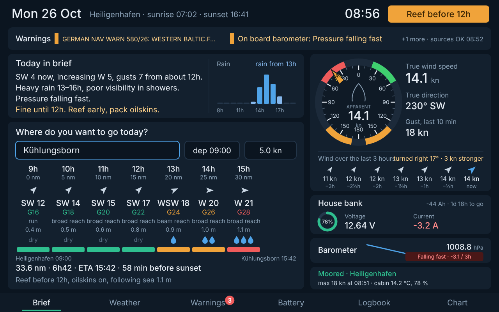
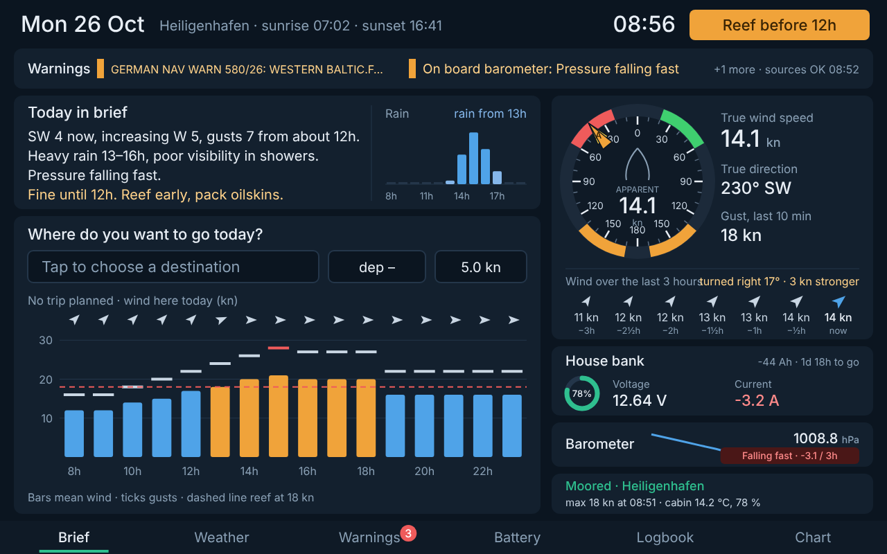

# Sailpartner

The morning brief screen for a sailing boat running Signal K: one look at the chart table tells you whether to go, when to reef and what the day brings.



## What's on the brief

| Area | Content | Data |
|---|---|---|
| Header | Date, place, sunrise/sunset, clock, **verdict** (Good sailing / Reef before 12h / Stay in) | Open-Meteo, your thresholds, warnings, barometer |
| Warnings | The two most important warnings near you or on your route, source health | `signalk-baltic-warnings` notifications and `/status` |
| Today in brief | Three or four plain sentences: wind now and later in Beaufort, rain, pressure, the takeaway | Open-Meteo + on-board barometer |
| Rain | Next 12 hours, mm per hour | Open-Meteo |
| Where to today? | Pick a saved harbour, departure and speed (default 5 kn). For every hour: where you are, wind and gusts, point of sail for that leg, waves, rain, a green/amber/red bar. Distance, ETA, margin to sunset, tactical advice (reef before, preventer, oilskins, following sea) | Open-Meteo forecast **at the position and hour you'll be there**, Open-Meteo marine |
| Wind now | Bow-up wind dial (A = apparent, T = true), true speed and direction, 10-minute gust, arrows for the last 3 hours with "turned right 17° · 3 kn stronger" | Signal K wind paths |
| House bank | State of charge, voltage, current, Ah used, time to go | `electrical.batteries.*` (SmartShunt via `signalk-victron-ble`) |
| Barometer | Sparkline, 3-hour tendency with the classic thresholds | on-board sensor (BME280) |
| Boat | Moored / at anchor (with drift) / under way, overnight max wind, cabin temperature and humidity, yesterday's distance | Signal K, anchor alarm plugin |

Without a trip the planning panel shows the wind for the day at your berth instead:



## The verdict

Defaults for a ~32 ft cruiser like the Hanse 323, all adjustable in the plugin config:

| | Mean wind | Gusts |
|---|---|---|
| Reef (amber) | ≥ 18 kn | ≥ 24 kn |
| Red on the route bars | ≥ 25 kn | ≥ 28 kn |
| Stay in | ≥ 25 kn | ≥ 32 kn |

The verdict looks at the planned trip, or at the rest of the daylight when there is no trip. An *alarm*-level warning or a barometer falling very fast also gives "Stay in".

## Install on the Pi

Requires the Signal K server (OpenPlotter). No native dependencies, nothing to build.

```bash
cd ~/.signalk
npm install /path/to/sailpartner-0.1.0.tgz
sudo systemctl restart signalk
```

Enable **Sailpartner** under *Server → Plugin Config*. The screen is at `http://<pi>:3000/sailpartner/`. For the 10.1" display, start Chromium in kiosk mode on that address.

Check the paths in the plugin config: barometer (default `environment.outside.pressure`), cabin temperature/humidity (default `environment.inside.*`) and the battery id if you have more than one.

### Destinations

A starter list of western Baltic harbours around Heiligenhafen is built in. Positions and via points are **approximate and only used to sample the weather along the way** — not for navigation. Edit them in the plugin config.

## API

`/plugins/sailpartner/…`

| Method | Path | |
|---|---|---|
| GET | `/brief` | everything on the screen as JSON |
| GET | `/destinations` | saved harbours |
| PUT | `/trip` | `{ "destination": "Kühlungsborn", "departure": "09:00", "speedKn": 5 }` or `{ "name": "...", "points": [{latitude, longitude}, …] }` |
| DELETE | `/trip` | no trip today |

After a trip is planned the page also sends the route to `signalk-baltic-warnings`, so warnings near the route are flagged "on route".

## Try it on a laptop

```bash
npm run demo     # http://localhost:3333 — a simulated morning in Heiligenhafen with a front coming in
npm test
```

## Coming next

Weather, Warnings, Battery, Logbook and Chart pages (the tabs are there, tapping them says so).
