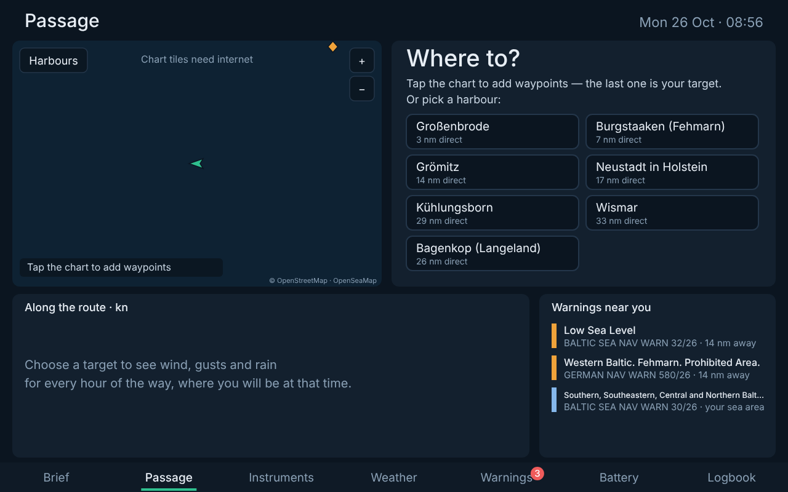
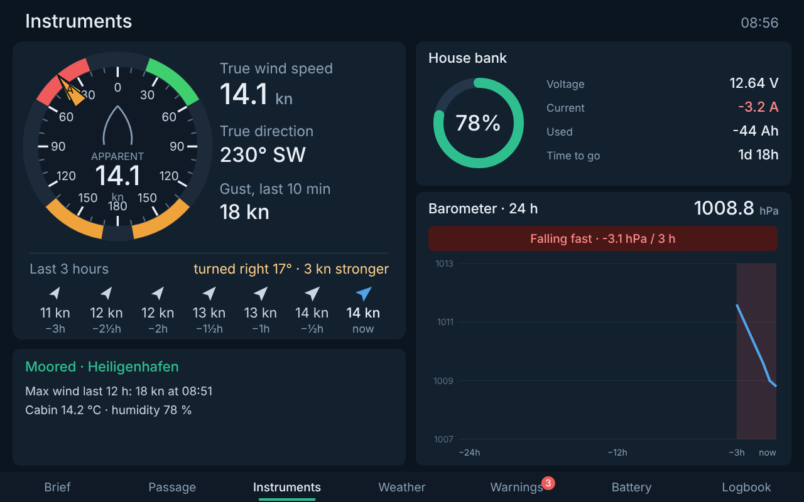

# Sailpartner

The morning brief screen for a sailing boat running Signal K. One look at the chart table tells you whether to go out today; a second tab plans the passage.

## Pages

### Brief — here, today


| Part | Content |
|---|---|
| Verdict | One answer for here and today: *Good sailing*, *Sail this morning*, *Sail until 15h*, *Reef before 12h*, *Stay in*. After 18h it looks at tomorrow |
| Two sentences | What the wind does (Beaufort, front, rain) and what to do about it |
| Day ribbon | 7h–19h at your position. One bar per hour: the solid part is the mean wind, the lighter top reaches up to the gusts. Green / amber (reef) / red. Dashed line: reef from gusts. Wind arrows, rain drops, *now*, the front and the dark hours after sunset |
| Needs your attention | At most three cards, only when something needs you: barometer falling or rising fast, warnings near you (from `signalk-baltic-warnings`), battery low, anchor drifting. Otherwise "Nothing needs your attention" |
| Status line | What's fine, at a glance: battery, wind now, cabin, warning sources |

### Passage — a trip


| Part | Content |
|---|---|
| Chart | OpenStreetMap with OpenSeaMap seamarks. **Tap to add waypoints**, the last one is your target; drag to pan, +/− to zoom, *Undo*, *Clear*, or *Harbours* to pick a saved one. Warnings are drawn on the chart: coloured when on your route, grey when only nearby |
| Trip | Distance, legs, duration; departure and speed with −/+; arrival |
| Trip verdict | e.g. *Reef before 12h · front at 13h, 20 nm out* |
| Better departure | Sailpartner tries every departure in 30-minute steps today and tomorrow (daylight) and suggests one with less strong wind, less rain and a daylight arrival. *Use* applies it |
| Along the route | The same gust bars, but for where you'll be each hour at your planning speed, with the point of sail for that leg and rain |
| Warnings on this route | From `signalk-baltic-warnings`, within the route corridor; nearby ones greyed out |

Without a trip the right side lists your saved harbours:



The chart tiles need internet (so does the forecast). They are cached by the browser.

### Instruments



Bow-up wind dial (A = apparent, T = true), true wind, 10-minute gust, the last 3 hours as arrows; SmartShunt battery; barometer over 24 hours with the 3-hour tendency.

*Weather, Warnings, Battery and Logbook pages follow.*

## The verdict

Defaults for a ~32 ft cruiser like the Hanse 323, all adjustable in the plugin config:

| | Mean wind | Gusts |
|---|---|---|
| Reef (amber) | ≥ 18 kn | ≥ 24 kn |
| Red | ≥ 25 kn | ≥ 28 kn |
| Stay in | ≥ 25 kn | ≥ 32 kn |

An *alarm*-level warning or a barometer falling very fast (> 6 hPa in 3 h) also gives "Stay in".

A **front** is detected when the forecast wind turns by 35° or more within two hours, together with more wind or rain.

## Install

See the [installation guide in the repository README](../../README.md#installation-on-the-raspberry-pi). In short:

```bash
git clone https://github.com/polimux/sailpartner.git
bash sailpartner/scripts/install-on-pi.sh
```

Enable **Sailpartner** in *Server → Plugin Config*, open `http://<pi>:3000/sailpartner/`.

## Configuration

| Setting | Default |
|---|---|
| Time zone | Europe/Berlin |
| Planning speed | 5 kn |
| Reef / red / stay-in thresholds | see above |
| Battery id | first found under `electrical.batteries` |
| Barometer path | `environment.outside.pressure` |
| Cabin temperature / humidity | `environment.inside.temperature`, `environment.inside.relativeHumidity` |
| Home port, saved harbours | Heiligenhafen and western Baltic harbours — **approximate positions, only used to sample the weather along the way, not for navigation** |

## API

`/plugins/sailpartner/…`

| Method | Path | |
|---|---|---|
| GET | `/brief` | the Brief and Instruments data |
| GET | `/passage` | the planned trip with route weather, verdict, better departure |
| PUT | `/trip` | `{ "destination": "Kühlungsborn" }` or `{ "waypoints": [{latitude, longitude}, …] }` (from the boat) or `{ "points": [...] }` (full route), plus optional `departure` (`"09:00"` or ISO) and `speedKn`. Fields left out keep their value |
| DELETE | `/trip` | no trip |
| GET | `/destinations` | saved harbours |

The page sends the planned route to `signalk-baltic-warnings` (`PUT /plugins/signalk-baltic-warnings/route`), so warnings near it are flagged "on route".

## Development

```bash
npm test
npm run demo   # http://localhost:3333 — simulated morning, no boat needed
```

The demo also runs `signalk-baltic-warnings` from the repository with a saved copy of the BALTICO warnings page.
